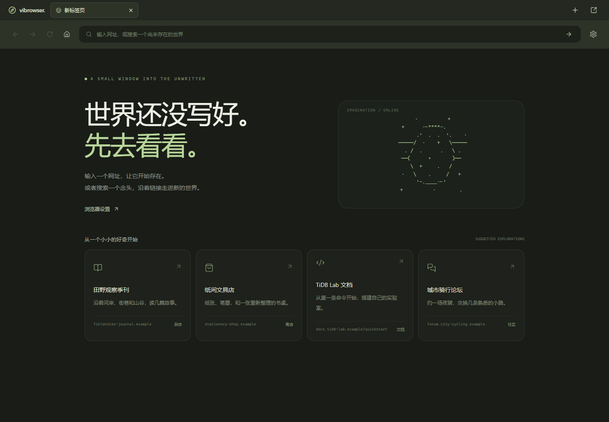

# Vibrowser

> Browse what exists. Imagine what doesn't.

本地运行的 AI 浏览器。输入网址或搜索词，AI 生成 HTML/CSS 网页；站内搜索、展开、筛选、排序、规格选择、临时购物车和区域追加由宿主运行时驱动。新页面使用 WebDocument v3，旧 v1/v2 书签继续可读。只有书签长期保留；未收藏页面再次地址导航或刷新会重新生成，会话内前进/后退恢复原版本。地址栏可选择幻觉模式自由创作，或认真模式通过 DeepSeek Search / Fetch 汇集互联网资料。设置在独立内部标签中打开。见 [双模式与设置页](docs/DUAL_MODES.md) 及 [WebDocument v3 验收](docs/WEB_DOCUMENTS.md)。



## 启动

已验证环境：Windows、Node.js 22.19、Java 25、PostgreSQL 16。Scala 3.3.7 / sbt 1.11.7 由项目脚本管理；前端依赖由 package-lock.json 固定。需要 java、node、npm 可从 PATH 调用。

在项目目录运行 PowerShell：

```powershell
# PostgreSQL 默认使用这套已安装程序；其他机器需修改此环境变量
$env:VIBROWSER_PG_BIN = 'D:\Installs\PostgreSQL\16\bin'
.\scripts\start.ps1
```

首次启动自动安装前端依赖、下载 sbt、编译后端并初始化数据库，可能需要几分钟。打开 **http://127.0.0.1:5173/**。后端只监听 127.0.0.1:8787，数据库只监听 127.0.0.1:55432，不修改已有的 5432 实例。

```powershell
.\scripts\stop.ps1                 # 停止记录的应用进程和项目数据库
.\scripts\start.ps1 -Mock          # 不调用模型、无需 Key 的固定样例演示
.\scripts\start.ps1 -SkipBuild     # 源码未变时跳过编译
.\scripts\start.ps1 -Wait          # 当前终端保持等待，适合开发工具会话
```

切换模式前先停止旧实例。脚本拒绝占用中的端口，不结束不属于本项目的进程。请在启动应用的 Windows 用户/会话中停止应用；若开发工具隔离了进程，需结束原启动终端。

Windows PowerShell 5.1 与 PowerShell 7 均可启动。若旧版本脚本在 `database.ps1` 的 `psql` 探测处报 `Connection refused` / `NativeCommandError`，请使用包含 2026-11-05 修复的脚本：数据库尚未运行属于正常冷启动状态，探测失败后应继续启动数据库。Java 25 的 `Unsafe` / `native access` WARNING 不代表编译失败。排查与验证见 [启动兼容性记录](docs/STARTUP.md)。

## 配置模型与真实验收

1. 点击右上角“设置”，选择 DeepSeek 官方、TokenHub 或自定义兼容接口。
2. 确认 Base URL 与模型名，填写 API Key，点击“保存设置”，再“测试生成连接”。
3. 在“联网检索”选择复用官方生成凭据或单独填写官方 Key，保存后“测试联网搜索”。地址栏切换“认真”后可输入“清华大学袁洋老师的个人主页.com”。
4. 在幻觉模式输入 `moon-coffee.example`，等待网站生成。
5. 输入“月球旅行”，点击一个虚构搜索结果，再后退和刷新。
6. 停止并重新启动应用，确认配置和已收藏网页仍可读取。

官方预设为 `https://api.deepseek.com` / `deepseek-flash`；TokenHub 预设为 `https://tokenhub.tencentmaas.com/v1` / `deepseek-v4.1-flash`。模型允许编辑，以账户实际权限为准。Base URL 不包含 `/chat/completions`，后端会自动追加。自定义接口需要兼容 chat completions、JSON mode 和非流式响应。

密钥通过 Windows 当前用户 DPAPI 加密，保存到本机 PostgreSQL。设置查询只返回 URL、模型、revision 与 hasKey；浏览器仅在填写时短暂持有明文，不保存到 localStorage。更换地址必须重新填写 Key。密钥不能随数据库复制到其他 Windows 用户后直接解密。

Mock 的测试连接与生成均为模拟，连接测试结果在设置中说明；真实模式不会读取 Mock 缓存。没有有效 Key 时，真实模式给出可重试错误，不回退到假生成。

## 本版能力与限制

- 中文域名与原始输入的含义独立传给模型，规范网址仅用于缓存和链接；修复记录及已有缓存说明见 [地址语义排查](docs/ADDRESS_INTENT.md)。

- 加载面板轻微弹入/淡出、单一滚动区，网页成功替换时整体淡入；悬停或聚焦链接在左下角预览目标。PageSpec v2 沿点击路径继承帖子/文章/商品实体事实，旧缓存保持读取，详见 [真实三页连续点击验收](docs/CONTINUITY.md)。

- 多标签中文浏览器外壳与独立新窗口；各标签独立历史、地址草稿、滚动位置和加载状态，支持新建/切换/关闭、前进/后退/刷新。顶部标题与标签居中对齐，已移除左侧栏，详见 [多标签验收](docs/BROWSER_TABS.md)。
- 顶部两栏统一 48px；非首页导航保留旧内容，右下角展示真实阶段，成功后再切换。地址栏星标保存书签，书签页跨窗口共享并在新标签打开原缓存，详见 [加载与书签验收](docs/BOOKMARKS_PROGRESS.md)。
- 裸域名、路径与 HTTP(S) URL 规范化；普通文字生成虚构搜索结果。幻觉模式将地址作为创作素材；认真模式理解输入需求并通过官方工具搜索、读取来源。
- 旧 v1/v2 PageSpec 支持杂志、商店、文档、社区、工作台、作品集、目录和通用布局；4 套字体、7 种背景主题、可变密度、1–4 列网格与连续主侧栏。文章、商品、讨论、代码、引用等按内容组织，最多 48 个组件、4 层嵌套。详见 [布局扩展与真实验收](docs/LAYOUTS.md)。新生成使用自由 HTML/CSS 的 v3 协议，见 [v3 验收](docs/WEB_DOCUMENTS.md)。
- 浏览器与生成页面取消说明性页脚；生成文案采用站点自身口吻，直接呈现品牌、栏目和正文。旧 footer 类型仅保留协议兼容，不渲染。此次缓存清理及验证见 [界面与文案调整](docs/IMMERSIVE_COPY.md)。
- 单 worker；v3 页面生成与区域更新最多 4 次模型请求（网络重试与内容修复共用），每次最多 180 秒；认真模式另有一次轻量规划与最多 4 次 Search、6 次 Fetch，检索阶段总预算 90 秒。鉴权、额度、限流错误立即失败。前端等待最多 20 分钟；加载过程中无需刷新。绑定、表单兼容与真实失败回放见 [生成可靠性修复](docs/GENERATION_RELIABILITY.md)。
- 短事务、书签缓存、并发去重、代次检查与重启清理。未收藏的临时页面和动作任务在正常重启后清理；书签保留原版本。
- 本版不含虚构文件、生图、完整站点世界设定、部署与账户体系。模型调用不承诺严格只计费一次。

## 数据与配置

项目运行数据全部位于 Git 忽略目录：

| 位置 | 用途 |
| --- | --- |
| `.data/postgres` | 独立 PostgreSQL 实例，数据库 vibrowser |
| `.data/*log`、`.data/runtime.json` | 启动日志、带创建时间的进程记录 |
| `.cache` | sbt / Maven / Playwright 缓存、编译运行 classpath |
| 浏览器 sessionStorage | 每窗口独立标签会话，每标签最多 100 条导航记录，不含密钥；自动迁移原 localStorage 单标签历史 |

数据库分别使用 `vibrowser_live`（真实）、`vibrowser_demo`（Mock）、`smoke_test`（集成测试）schema，业务表包括 pages、generation_jobs、provider_settings、provider_credentials、bookmarks、page_actions、research_settings、research_snapshots。任务包含持久化的步骤记录；书签与网页重启后保留。开发初始化为仅限本机的 trust 认证；此配置不用于部署。

可选后端环境变量：`VIBROWSER_DB_URL`、`VIBROWSER_DB_USER`、`VIBROWSER_DB_PASSWORD`。启动脚本不会自动读取 .env；请在 PowerShell 中显式赋值。使用自定义数据库时必须自行准备权限和独立 currentSchema。Key 通过设置面板管理，不需要环境变量。

## 验证

```powershell
.\scripts\check.ps1                # Scala 格式/编译/测试，前端格式/测试/类型/构建
# 浏览器测试分旧格式 Mock 与默认 v3 Mock 运行，命令见 docs/DUAL_MODES.md
# check.ps1 在后端停止时执行；浏览器测试用 npm / npx 执行，避免重编译运行中的后端。
```

数据库测试只清理 `smoke_test` schema。E2E 强制检查 Mock 模式，不进行计费调用；若已有 Key，跳过会替换凭据的 UI 用例。真实验收另用显式启用的 `npm run test:live`，不读取或替换 Key；调用方式、重启阶段和结果见 [真实验收记录](docs/LIVE_SMOKE.md)。首次交付的历史证据见 [Smoke 记录](docs/SMOKE_PROGRESS.md)。

## 代码入口

后端按课程要求组织在 `services/browser、generation、settings、system`。每个 API 是独立消息类，输入作为构造参数，执行入口为 `plan(connection: Connection): IO[Response]`；表方法返回 IO，私有 SQL 位于对应方法前。前端使用对应消息类的 `send()`。

- [开发路线与后续范围](docs/ROADMAP.md)
- [架构与接口](docs/ARCHITECTURE.md)
- [课程规范与实现证据](docs/COURSE_STANDARDS.md)
- [资料与 API 核验](docs/SOURCES.md)
- [生成页面](docs/screenshots/generated-page.png) · [搜索](docs/screenshots/search.png) · [设置](docs/screenshots/settings.png) · [移动布局](docs/screenshots/mobile.png)

源码与中文文档为 UTF-8。本地 Git 用户为 666DHG / 47705871+666DHG@users.noreply.github.com；未创建远程仓库或发布网站。
