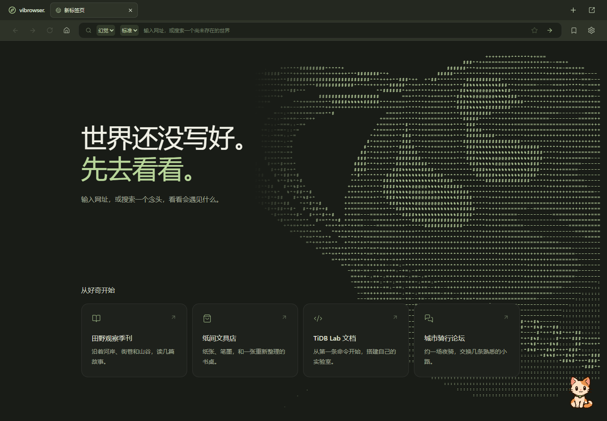

# Vibrowser

> 世界还没写好，先去看看。
>
> Browse what exists. Imagine what doesn't.

一个本地运行的 AI 浏览器：输入网址或一个念头，让 AI 为你生成可探索、可交互的网页。

**灵感来源：VibeOS。** Vibrowser 将这份灵感带入浏览器，让输入、点击和浏览成为构建页面的过程。



## 特性

- **两种浏览模式**：幻觉模式自由生成虚构网站；认真模式检索互联网资料，并展示来源。
- **可交互的页面**：支持站内搜索、展开、筛选、排序和局部更新，沿链接继续探索。
- **熟悉的浏览体验**：多标签、多窗口、前进后退和书签；收藏的页面可长期保留。
- **可选模型与思考强度**：支持 DeepSeek、TokenHub 和自定义兼容接口，官方接口提供标准／深入两挡思考。
- **像素小猫陪伴**：可拖拽、可点击互动，用气泡展示真实加载进度，支持可选 AI 短回应。
- **动态 ASCII 星球**：纯文字呈现旋转星球、星环与流星，支持拖动和减少动态效果。

## 快速开始

已验证环境：**Windows、Node.js 22.19、Java 25、PostgreSQL 16**。确保 `git`、`node`、`npm` 和 `java` 可从终端调用。

```powershell
git clone https://github.com/666DHG/vibrowser.git
cd vibrowser
.\scripts\start.ps1
```

首次启动会安装依赖、编译后端并初始化本地数据库。完成后打开 **http://127.0.0.1:5173/**。

1. 在右上角「设置」中选择模型服务，填写 API Key，保存并测试连接。
2. 在地址栏输入 `moon-coffee.example` 或「月球旅行」，开始探索。
3. 使用认真模式前，在设置中配置联网检索；目前使用 DeepSeek 官方 Search / Fetch。

PostgreSQL 会从 PATH 或 Windows 标准安装目录自动查找。自定义安装时，在启动前指定：

```powershell
$env:VIBROWSER_PG_BIN = 'C:\Program Files\PostgreSQL\16\bin'
```

不使用 API Key 也可以体验固定样例：

```powershell
.\scripts\start.ps1 -Mock   # 固定演示，不调用真实模型
.\scripts\stop.ps1          # 停止本项目服务
```

切换真实／Mock 模式前先停止服务。密钥使用 Windows 当前用户加密保存，运行数据留在本机；未收藏页面可能在刷新或重新导航时重新生成。

技术栈：React / TypeScript · Scala 3 / Cats Effect / http4s · PostgreSQL。

[启动排查](docs/STARTUP.md) · [浏览模式与设置](docs/DUAL_MODES.md) · [课程规范](docs/COURSE_STANDARDS.md)
