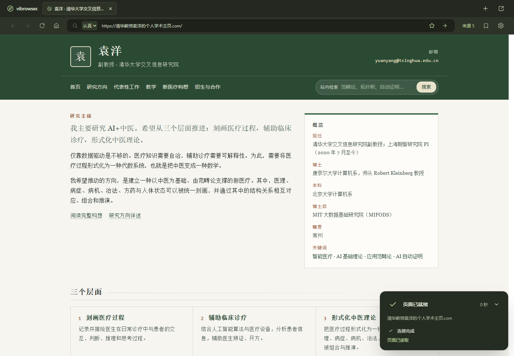
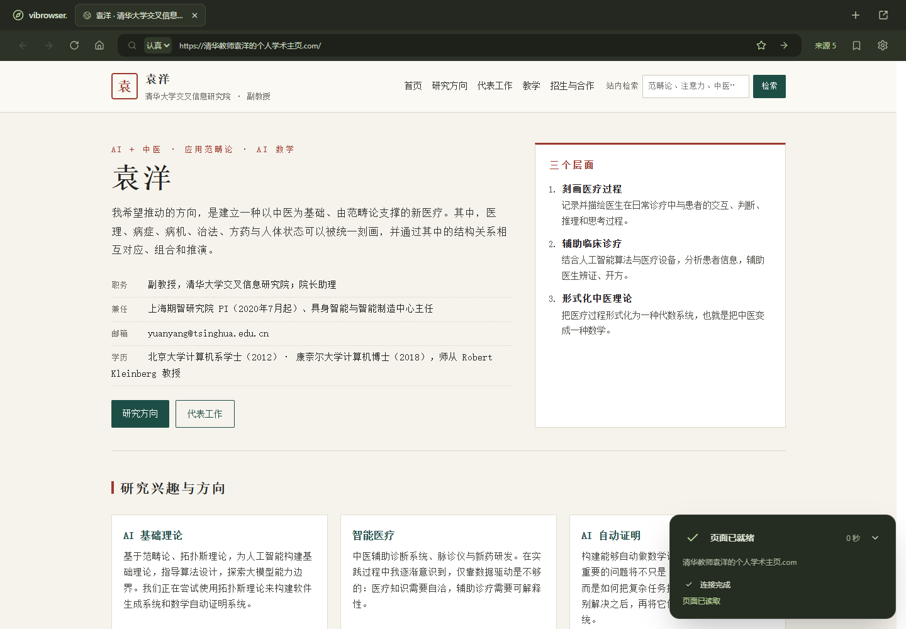

# 学术主页无法加载：实体片段标识被删除

日期：2026-11-05 晚间。用户报告输入：`清华教师袁洋的个人学术主页.com`，认真模式。

## 根因与修复

原页面 `43dc7f05-2fa1-4a46-9805-82e5176a4795` 的两次失败任务均用尽四次生成请求，八次都返回 `duplicate entity id`。

检查保留的模型原文发现，模型实际给三篇不同论文分配了不同标识，例如：

```text
https://people.iiis.tsinghua.edu.cn/~yuanyang/index.html#foundation-models
https://people.iiis.tsinghua.edu.cn/~yuanyang/index.html#contrastive
https://people.iiis.tsinghua.edu.cn/~yuanyang/index.html#efficiency
```

应用的 `NormalizeWebDocumentMessage` 与内联绑定转换复用了页面导航的 `AddressRules.resolveLink`。这个方法为页面缓存去除 fragment，结果把三个不同实体改成同一个 URL，随后校验器拒绝整页。模型收到重复 ID 错误后继续输出不同 fragment，但应用再次将它们删除，因此连续修复无法解决。

本轮新增独立的 `resolveEntityId`：沿用 HTTP(S)、域名、路径和端口规范化，额外保留 ASCII 编码后的 fragment。实体列表、显式绑定、内联实体标记及实体 URL 校验采用一致的规则。页面导航和缓存仍使用原有不含 fragment 的页面身份。真正重复的实体继续拒绝，错误现在列出具体重复标识。

未合并不同论文、未删除实体或正文、未关闭引用校验，也没有增加模型尝试次数。v1/v2 原有规则与书签保持不变。课程架构沿用 browser 私有工具、独立消息 `plan(connection): IO`，本轮没有新增表或转发层。

## 历史原文回放

八个原始输出全部保留在本机忽略目录 `.cache/academic-failure.json` / `.cache/academic-replay.json`。没有对模型原文改写后再测试。

- 任务 `8e30155f-645b-44c2-9d7c-c9b824031312` 的四个输出：修复后均能直接通过解码、规范化与结构校验。
- 任务 `757e12dd-1919-4f8c-9d0f-1aebce5699df` 的四个输出：重复 ID 错误消失，但暴露出 `act-join` 的 Submit 动作没有声明结果区域。仍按协议拒绝，报告明确记录这四个未通过的输出；不能算作八个页面全部通过。
- 回放套件同时验证四个接受结果和四个明确拒绝结果。它没有调用模型，不代表一次真实生成。

证据：[逐输出回放](acceptance/academic-fragments-replay-2026-11-05.json)、[原失败及修复后的任务诊断](acceptance/academic-fragments-attempts-2026-11-05.json)。提交的记录不含密钥或完整模型原文。

## 自动验证

- Scala 格式、编译与 PostgreSQL 集成测试：**84 项常规测试通过**，加上 **1 项包含八个输出的回放测试，共 85 项通过**。
- 新回归覆盖：同一主页下独立论文绑定、显式/内联两种引用、规范化重复执行、真正重复实体仍拒绝、中文域名/片段、百分号不重复编码、非法协议/私网/凭据 URL 拒绝，以及页面缓存身份保持原行为。
- 前端格式、42 项单测、类型检查、生产构建通过。
- 浏览器运行时回归 4 项通过：论坛、商店、文档、输入法与连续搜索。

本地可选回放：

```powershell
$env:VIBROWSER_GENERATION_REPLAY = 'true'
$env:VIBROWSER_REPLAY_INPUT = '../.cache/academic-replay.json'
$env:VIBROWSER_REPLAY_REPORT = '../docs/acceptance/academic-fragments-replay-2026-11-05.json'
.\scripts\sbt.ps1 'testOnly services.generation.GenerationReplaySuite'
```

这三个变量仅影响测试；样本文件需来自本机已捕获的输出。

## 真实 DeepSeek 验收

使用现有官方凭据，保留原始输入，不换域名、不加测试路径。

| 场景 | pageId / jobId | 生成次数 | 结果 |
| --- | --- | ---: | --- |
| 原失败任务显式重试 | page `43dc7f05-2fa1-4a46-9805-82e5176a4795` / job `6f7ef6d6-3121-45e0-8154-74b95fc9d761` | 1 | 首轮成功；保留主页与三篇论文的不同实体 ID；复用原检索资料 |
| 同一输入全新导航 | page `e02d21f8-f00a-41c5-949c-d75c6f244695` / job `91933e51-2732-40dd-9dbd-8f8f532f222a` | 2 | 首轮 subjectEntityId 引用了未声明的实体，修复后成功；重新执行检索 |

两次真实验收 **首轮 1/2，最终 2/2**。第二次失败属于模型主体引用不一致，没有将它包装为首轮成功。这个定向样本证明所报告地址恢复加载，不用来推断所有输入的成功率。

浏览器读取两页后检查 h1 可见、所有 Title 绑定对应的文本等于各自实体标题，保存截图；读取与展示期间没有 Navigate/Retry/Submit 请求。证据：[真实结果](acceptance/academic-fragments-live-2026-11-05.json)。





## 交付状态

已启动包含修复的 LIVE 服务。为让用户能够继续查看原失败标签，本轮重启使用保留临时页的启动开关，原页面已恢复 ready，未更改任何书签或设置；下次普通启动仍执行现有未收藏页面清理策略。旧失败任务及这次成功任务分别保留。

后续重点是继续审查实体身份与页面身份的使用位置，并扩大引用冲突回归样本。表单区域缺失、主体引用遗漏等模型协议错误仍通过现有有限修复处理。
