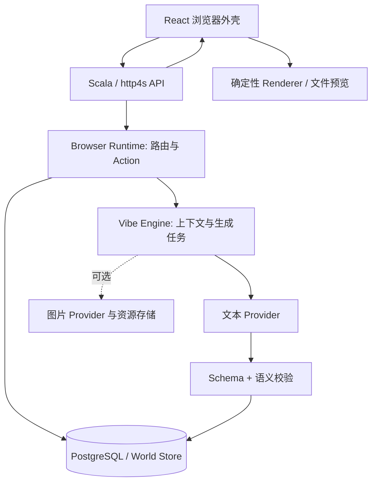

# 架构与开发边界

本文是待实现的设计基线，不代表已有接口或数据库。具体字段在 D1.1 固化为机器可校验契约。

## 职责分层



单体后端即可。Browser Runtime、Vibe Engine、World Store 是责任边界，不是三个微服务。所有 AI 请求通过 Scala 后端。

建议结构（尚未创建）：

```text
frontend/src/       browser/ renderer/ api/
backend/src/main/scala/  api/ domain/ service/ infrastructure/
backend/src/main/resources/db/migration/
contracts/          schemas/ fixtures/
docs/
```

前端采用 TypeScript 判别联合；后端采用 Scala ADT。持久化可选 Doobie、JSON 编解码可选 Circe；这些属于本次建议，依赖版本和兼容性在 D1.2 核验后锁定。Schema 是跨端契约依据，用共享 fixtures 避免两端规则漂移。

## 内容与 Action

| 对象 | 应包含的核心信息 |
| --- | --- |
| PageSpec | schemaVersion、title、theme、blocks；pageId/url/status 由后端维护 |
| FileSpec | schemaVersion、format（md/txt/json）、content；路径由后端维护 |
| BrowserAction | `navigate(target)`、`toggle(targetId)`；可选 `generate(operation=search)` |
| SiteProfile | 域名、名称、摘要、主题、已确定实体 |
| GenerationContext | 目标地址、来源页面/Action、站点设定、有限近期摘要、设计约束 |

初始组件：navbar、hero、text、image、card、grid、button、footer。搜索列为 P1，届时再加入 search 组件。样式仅开放颜色、字体枚举、间距、列数等受控字段。

建议初始限制：每页总组件数不超过 12（含嵌套），最大深度 3，图片请求不超过 3。文本长度、请求体大小、上下文预算也在契约阶段给出明确上限。

- `navigate`：前端向后端请求规范化目标，缓存不存在才生成。
- `toggle`：本地可见性等状态切换，不需要 AI。
- `generate/search`：提交 pageId、actionId、用户输入与幂等请求 ID；后端从已存 PageSpec 查找并验证 Action，不信任客户端自报操作或模型指令。
- 网页按钮统一使用 Action；不混用对话早期的 `href` 简写与后期的 Action 示例。
- 普通刷新只重新读取；“重新生成”作为后续独立功能，不能隐式覆盖旧内容。

Markdown 禁用原始 HTML，TXT 按纯文本展示，JSON 解析后展示。任何格式均不得执行脚本。虚构文件仅提供文中所需的有限预览，不实现完整编辑器。

## 导航与地址

默认是 **Vibe 模式**：HTTP(S) 地址作为虚拟内容的键，不做 DNS 存活探测，也不尝试抓取任意网址。真实网页通过用户显式选择的外部打开入口访问。

相对链接使用来源页面地址解析；主机名大小写、默认端口和空路径需要统一；保留可能影响内容的 query 参数与顺序；fragment 作为页内定位不进入页面缓存键。路径大小写和尾部斜杠不盲目合并。

`file:///...` 进入独立虚拟命名空间；拒绝非空 host/UNC、路径穿越、未支持扩展名，不调用宿主文件系统。HTTP(S) 拒绝带凭证地址以及 localhost、内网/回环 IP 等目标；禁用 javascript/data 等导航协议。后续真实外部入口沿用协议校验。

## API 草案

| API | 语义 |
| --- | --- |
| `POST /api/navigate` | 输入 url、可选 referrerPageId；缓存成功返回 200；新建/复用进行中任务返回 202 + pageId/jobId |
| `GET /api/pages/{id}` | 轮询页面 status、phase、内容或错误；此操作不创建生成任务 |
| `POST /api/actions` | P1 搜索入口；输入 pageId/actionId/input/requestId，返回目标页面或任务 |
| `GET /api/assets/{id}` | P1 图片状态和受控资源地址；图片状态与页面状态分开 |

未找到返回 404，输入不合法返回 400，超过预算或限流返回 429；不可用的 provider 与内部错误使用稳定错误码并带可读提示，不返回 Key 或 provider 原始敏感响应。

页面状态：`generating → ready | failed`。生成阶段：`queued → generating → validating → saving`。素材状态单独维护 `pending → ready | failed`，页面 ready 不必等待图片。

校验失败最多触发一次修复生成；网络重试与修复共享总尝试次数上限，建议每个生成任务最多两次文本 provider 请求并设置总截止时间。鉴权、额度错误直接失败。前端轮询应退避、有截止时间且在切页后停止；用户主动重试失败页时创建新任务并保留失败记录。

## 持久化与一致性

| 表 | 建议字段 / 约束 |
| --- | --- |
| sites | id、domain UNIQUE、profile JSONB、created_at/updated_at |
| pages | id、canonical_url UNIQUE、site_id 可空、kind、spec JSONB、summary、status、created_at/updated_at |
| generation_jobs | id、page_id、status、phase、attempts、error_code、started_at、finished_at |

三张表支撑单用户本地 MVP；history/tabs 暂存浏览器 localStorage，页面与文件内容存 PostgreSQL。图片接入时再增加 assets 表和本地受控资源目录，不把临时 provider URL 当持久资源。

同 URL 的生成通过数据库唯一键和事务协调；同一 page 只允许一个活动任务。先创建或找到 page/job，再由受管理 worker 执行，不能依赖 HTTP 请求内脱离生命周期的裸后台协程。

同域名首次并发生成时也要协调 SiteProfile 创建，避免两个页面各自保存冲突品牌。任务成功应在事务内保存合法内容并更新状态。启动时处理遗留任务，可重新排队或标记 interrupted，不能永久留在 generating。

上下文复用 SiteProfile、来源页面和有限近期摘要，不发送全部历史。已存实体优先于模型新推测；一致性以保存的设定为准，复杂语义一致性属于后续改进。

## 外部能力核验

- DeepSeek 官方与 TokenHub 是不同的 provider 配置，模型 ID、地域、参数不能混用。
- 学生说明与腾讯官方模型列表均列出了 `deepseek-v4.1-flash`，但当前 Key 的授权、额度和实际返回尚未测试。
- JSON 输出模式仍须处理空白、截断和业务 Schema 错误；TokenHub 参数行为需要实测。
- 学生说明包含全景图，不等于授权了常规网页配图模型。先检查权限再决定图片 adapter；不以生图可用作为 P0 前提。
- 图片下载只接受经过验证的 provider 资源域名，并限制重定向、大小与类型；不下载模型自由指定的 URL。

官方依据和核验日期见 [SOURCES.md](SOURCES.md)。
