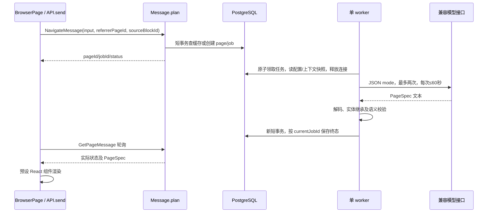
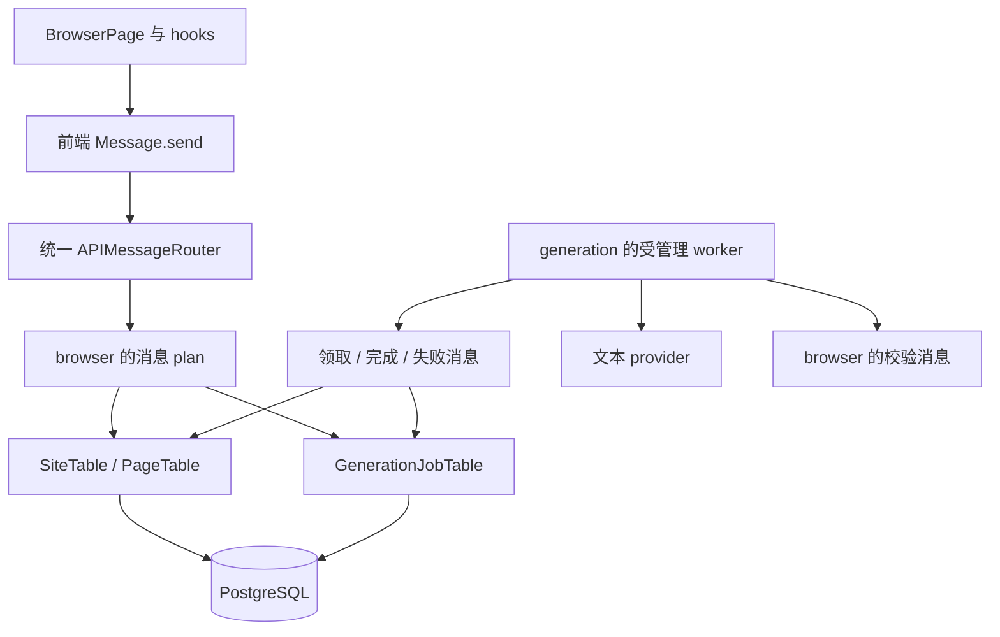

# 架构与开发边界

本文先记录 Smoke 的实际实现，再保留长期设计基线。依据课程讲义与本地 rules.txt 修订。具体任务见 [ROADMAP.md](ROADMAP.md)，规范出处见 [COURSE_STANDARDS.md](COURSE_STANDARDS.md)。长期部分的 SiteProfile、FileSpec、Action、SiteTable 尚未实现。

## 首版实际结构（2026-11-03）

新增 PageSpec v2 实体与来源组件 ID：NavigateMessage 在短事务中验证父页目标并保存 navigation_context 快照；worker 读取快照，在 generation 内部完成继承补齐/冲突检查，再调用 browser 的语义校验消息。模型请求不再拼接截断的父页 JSON。v1 缓存仍可读取；实体标题/元信息由宿主渲染，详见 [上下文与动效实现](CONTINUITY.md)。加载 UI 使用 requestId 隔离的存在状态 hook，面板只有一个滚动内容区；预览与点击共用地址解析。

最新交互增强将每标签 ContentState 与 PendingNavigation 分开：旧页直到新请求成功才替换，历史也在成功后提交；进度面板读取任务的持久化 steps。书签归属 browser 服务，新增三个消息，全应用现有五张业务表，详见 [加载与书签](BOOKMARKS_PROGRESS.md)。

浏览器会话已扩展为 BrowserSession → BrowserTab[]，每标签独立 ContentState、历史、草稿和请求取消控制器；sessionStorage 按窗口隔离。BrowserTabs 与 TabContent 就近拆分，消息与数据库接口保持不变。后台完成按捕获的 tabId 写入，关闭标签后不接收迟到结果，见 [多标签实现与验收](BROWSER_TABS.md)。

界面后续调整：移除浏览器状态底栏与生成页 footer；Prompt 采用站点自身口吻。旧 PageSpec 的 footer 类型继续可解码，但 Renderer 不输出，避免已有缓存恢复旧页脚。文案变更与本机缓存维护记录见 [IMMERSIVE_COPY.md](IMMERSIVE_COPY.md)。最新布局扩展已替换原先的八组件示例与固定搜索数量建议，改为三种不同结构的示例，按实际内容决定组件数量，见 [LAYOUTS.md](LAYOUTS.md)。

页面契约增加可选 PageDesign（布局、字体、密度、强调色）、BlockStyle（变体、主/侧/通栏位置、网格列数）和 meta。均使用独立 final case class 与封闭 enum；旧 JSON 缺少这些字段仍可读取。全树上限为 48 个组件/4 层。前端分为 PageRenderer（连续区域）、PageBlockView（容器）、ContentBlock（内容）、pageDesign（纯样式/分组计算），模型只选择类型化数据，实际布局由 Tailwind 组件实现。

四个逻辑服务同进程运行：browser 管导航、内容与缓存；generation 管任务和模型调用；settings 管接口配置与 DPAPI；system 管 HTTP、事务与资源。业务入口均为独立 Message.plan，前端同名类通过 send 调用。没有仅转发的 Service。

| 消息 | POST 路径 | 返回与责任 |
| --- | --- | --- |
| NavigateMessage | /api/navigate | NavigationResponse；识别网址/搜索、复用缓存或验证 sourceBlockId 并保存点击快照/建任务 |
| GetPageMessage | /api/getpage | PageResponse；pageId/jobId 二选一查询 |
| RetryPageMessage | /api/retrypage | 检查 failedJobId，锁页面并创建或复用下一代任务 |
| ListBookmarksMessage | /api/listbookmarks | 返回当前 schema 的书签列表，按保存时间倒序 |
| SaveBookmarkMessage | /api/savebookmark | 读取已就绪 pageId，以服务端标题/地址保存，重复收藏幂等 |
| RemoveBookmarkMessage | /api/removebookmark | 只删除书签，不删除页面缓存 |
| GetSettingsMessage | /api/getsettings | ProviderSettings；只含非敏感配置与 hasKey |
| SaveSettingsMessage | /api/savesettings | 保存配置并加密新 Key，增加 revision |
| ClearCredentialsMessage | /api/clearcredentials | 删除密文并使旧配置 revision 失效 |
| TestConnectionMessage | /api/testconnection | 返回 jobId；使用 GetPage 查询连接测试结果 |

无输入消息使用空 JSON 对象。内部领取、阶段更新、完成、失败、内容校验与读取解密配置消息不注册 HTTP。路由按类型名去掉 Message 后转小写，生产前端不依赖可被压缩的 constructor.name。

| 表 | 核心字段与约束 | 所属模块 |
| --- | --- | --- |
| pages | id、唯一 address、kind、prompt、status、JSONB spec、JSONB navigation_context、current_job_id、referrer_id、error、source、created_at | browser |
| generation_jobs | id、page_id、kind、status、phase、steps JSONB、error、settings_revision、时间；每页仅一个 queued/running 任务 | generation |
| bookmarks | id、唯一 page_id、title、address、kind、saved_at；页面外键 | browser |
| provider_settings | singleton id=1、base_url、model、revision | settings |
| provider_credentials | settings 外键 id、DPAPI ciphertext BYTEA | settings |

PageId 与 JobId 使用独立 final case class，传输时编码为 UUID 字符串。PageBlock 使用封闭 BlockType 加统一数据字段，语义校验约束不同组件的字段和嵌套。PageStatus 为 generating/ready/failed，JobStatus 为 queued/running/succeeded/failed。phase 只用于显示领取/校验/保存进度，不作为任务状态判断依据。



DatabaseSession、SQL statement/resultSet、HTTP client 与 worker 由 Resource 管理。SqlExecutor 是 system 的技术性 JDBC 执行工具，业务 SQL、参数和行映射仍由所属 Table 私有持有。外部模型请求期间不占数据库连接。

真实、Mock 与集成测试分别使用 vibrowser_live、vibrowser_demo、smoke_test schema；页面保存 source=live/mock。启动时将遗留 running 任务标记失败并更新页面，queued 继续运行。前端 AbortController 防止旧导航覆盖新状态，刷新只 GetPage，不隐式再生成。

真实接口联调后，在 generation 的纯工具 GeneratedPageDecoder 中加入模型边界归一化：navbar 子项的 label/href 简写转换为 button，grid/results 中无 type 的标题卡片转换为 card；缺失 ID 按树路径生成，缺失可空文本和空 items 补齐。显式未知 type 不改写；链接、重复 ID 与组件预算仍通过语义校验，本轮预算更新为全树 48 个组件及 4 层深度。写入数据库和交给前端的仍是严格 PageSpec。错误保留字段路径，唯一一次修复携带有长度限制的原输出与具体校验原因；不截掉超限组件伪装成功。

仅监听 loopback；开发前端代理 /api 和 /health。路由校验 Host、Origin、JSON Content-Type 和请求大小，不允许任意 CORS。模型输出只作为数据；全部链接通过宿主导航，ASCII 插画仅渲染文本。Key 不写日志、不返回前端、不进入浏览器存储。

## 长期设计基线

## 1. 三个逻辑模块，单进程部署

| 模块 | 维护责任 | 不承担的责任 |
| --- | --- | --- |
| services/browser | 地址、页面与文件、站点设定、导航、内容校验；sites/pages | provider 网络调用、通用连接池 |
| services/generation | 生成任务、上下文装配、provider、worker、重试；generation_jobs | 浏览器 UI、宿主文件读取 |
| services/system | 消息框架、路由基础设施、连接/事务、配置、启动和共享错误 | 具体网页与生成业务规则 |

Browser Runtime、Vibe Engine、World Store 是概念责任：分别由浏览消息、生成模块、各服务所属 Table 落实，不为它们各建一个空转发 Service。



## 2. 目录与类的归属

以下为扩展目标结构；首版已有源码以开头的实际结构为准。SiteTable、FileSpec 等目录按实际功能引入，不预建空目录。

```text
backend/src/main/scala/services/
  browser/
    api/                    NavigateMessage.scala / GetPageMessage.scala / ...
    objects/                PageSpec.scala / FileSpec.scala / SiteProfile.scala / ...
      apiTypes/             NavigationResponse.scala / PageResponse.scala / ...
    routes/                 BrowserRoutes.scala
    tables/
      PageTable/            PageTable.scala / PageTableInitializer.scala
      SiteTable/            SiteTable.scala / SiteTableInitializer.scala
    utils/                  地址与内容校验、响应组装等内部函数
  generation/
    api/                    ClaimGenerationJobMessage.scala / CompleteGenerationJobMessage.scala / ...
    objects/                GenerationJob.scala / GenerationContext.scala / ...
      apiTypes/             ClaimJobResponse.scala / CompletionResponse.scala / ...
    tables/
      GenerationJobTable/   GenerationJobTable.scala / GenerationJobTableInitializer.scala
    utils/                  provider、Prompt、worker 的服务内部实现
    GenerationModule.scala  后台资源装配入口
  system/
    api/                    APIMessage.scala / NoRequestMessage.scala
    objects/                AppConfig.scala / RegisteredAPIMessage.scala / ...
    routes/                 APIMessageRouter.scala
    utils/                  系统内部配置与资源辅助函数
    DatabaseSession.scala   公共连接/事务基础设施
    Main.scala              IOApp 装配入口

frontend/src/
  apis/
    browser/                NavigateMessage.ts / GetPageMessage.ts / RetryPageMessage.ts
    system/                 通用发送、稳定 API 名称映射、错误处理
  pages/BrowserPage/
    index.tsx
    components/             TabBar / NavigationBar / ContentViewport / Renderer / ...
    hooks/
    stores/
    objects/
    functions/
  components/ui/            真正共享的基础 UI

contracts/
  schemas/
  fixtures/valid/
  fixtures/invalid/
docs/
```

generation 只有内部消息时不需要 Routes 或前端 API 文件；加入可公开的图片查询后再添加。根部 GenerationModule、DatabaseSession 和 Main 是明确的装配/基础设施文件，不新增无归属目录。system/utils 仍是系统私有；其他模块使用公开基础设施入口。

## 3. 允许的调用与数据流

- 路由：解码与边界转换 → 构造消息 → plan(connection) → 响应编码。
- API：调用其他消息的 plan、任意服务公开 Table def、当前服务私有 utils。
- Table：封装私有 SQL、参数绑定、执行和私有行映射，公开 IO[T] 方法。
- objects：纯数据、值定义、枚举与序列化；不查询、随机生成或编排工作流。
- utils：方法按所属服务标注 private[服务名]；跨服务业务能力通过 Message 公开。
- worker：在 generation 内协调资源与模型请求，通过公开消息进行领取、校验、完成/失败；不能访问 browser 私有工具。

跨服务 Table 访问是允许边界，不应添加只做转发的 Service。相反，需要实际业务校验的内容接受流程由消息负责，不能直接写表绕过校验。

## 4. 消息协议

统一 POST /api/{apiName}。规范消息名去掉末尾 Message 再转小写，由共享注册机制推导；前端使用同源稳定元数据，不依赖构建后的运行时 class 名。

| 消息 | 路由 | 结果 |
| --- | --- | --- |
| NavigateMessage | /api/navigate | NavigationResponse：ready 或 generating，包含 pageId 和必要的 jobId |
| GetPageMessage | /api/getpage | PageResponse：页面状态、实际阶段、内容或错误 |
| RetryPageMessage | /api/retrypage | 受 failedJobId 约束的新尝试或已创建的活动任务 |
| SubmitSearchMessage（P1） | /api/submitsearch | 搜索目标页或生成任务 |
| GetAssetMessage（P1） | /api/getasset | 独立图片状态与受控资源地址 |

成功的消息执行返回 200，由响应联合类型区分业务状态。输入不合法/不存在/冲突/限流等映射明确 HTTP 错误；已经存在的生成任务失败是可查询的页面状态。未知字段、错误码、响应上限在契约阶段固定。内部消息不注册 HTTP。

本协议取代早期 GET /api/pages/{id} 与 POST /api/actions 等 REST 草案，不同时维护两套语义。前端轮询 GetPage 消息，查询不得启动生成。

## 5. 类型与内容约束

PageSpec、FileSpec、SiteProfile 是不可变记录；PageBlock、BrowserAction、FileFormat、页面/任务状态用封闭类型。后端业务 ID 使用领域值类型，前端通过明确类型和运行时解码验证边界。

此处为长期设计示意：初始组件包括 navbar、hero、text、image、card、grid、button、footer；Action 为 navigate/toggle，搜索阶段增加 generate。当前实现已采用 48 个组件、4 层深度与扩展 BlockType，尚不支持 image 或复杂 Action，footer 只解码不渲染；以本页开头的当前结构为准。

内容 JSON 使用 schemaVersion。Scala 派生编解码与前端 type discriminator 需要 fixtures 对照，不能把类型可编译当成协议一致。

Markdown 禁用原始 HTML，TXT 按文本展示，JSON 文件内容本身也必须可解析。Renderer 不执行模型返回的 JS/TSX 或任意 CSS。主题采用静态 Tailwind 变体；必要的动态颜色仅通过经校验的 CSS 变量传递。

## 6. 导航规则

默认 Vibe 模式：HTTP(S) 地址作为虚构内容键，不做 DNS 探测或真实抓取。真实网页通过用户显式外部打开。

相对链接按来源地址解析；主机大小写、默认端口和空路径统一；保留 query 顺序、路径大小写和尾部斜杠意义；fragment 用于页内定位，不进页面缓存键。

file:/// 进入独立虚拟命名空间，拒绝非空 host/UNC、路径穿越和不支持扩展名，不调用宿主文件系统。导航拒绝带凭证地址、javascript/data 等协议及 localhost/内网/回环 IP 目标。下载 provider 图片是另一条受控资源链路，不使用任意页面地址。

刷新只读缓存；重新生成旧页面为后续独立能力。Retry 只针对失败任务，必须确认失败代次，不能无条件替换 ready 内容。

## 7. 数据库与状态

| 表 / 归属 | 字段方向 | 关键约束 |
| --- | --- | --- |
| sites / browser | id、domain、profile JSONB、时间 | domain 唯一；首次并发初始化协调 |
| pages / browser | id、canonical_url、site_id 可空、kind、spec JSONB、summary、status、时间 | 地址唯一；ready 有内容；当前任务一致性 |
| generation_jobs / generation | id、page_id、status、phase、attempts、error_code、开始/结束时间 | 每页一个活动任务；原子领取与条件终态更新 |

具体 SQL 和状态约束在 Table/Initializer 中落实。页面内容和文件存数据库，标签/历史先存 localStorage。图片阶段再引入 assets 与受控资源存储。

页面状态：generating → ready/failed。任务状态：queued → running → succeeded/failed；phase 表达 generating/validating/saving 等实际阶段。图片状态独立，不阻塞页面 ready。用户重试创建新 job，保留旧失败记录。

初始站点的 profile 尚未确定时，同站其他任务等待，不各自生成互相冲突的设定。上下文使用已存站点、来源与有限近期摘要，不能无限堆历史。

## 8. 连接、事务与 worker 生命周期

1. 路由从 DatabaseSession 获取短连接，运行 NavigateMessage，提交 page/job 创建后返回。
2. GenerationModule 装配受管理 worker。worker 另取连接执行领取消息，取得任务与上下文后释放连接。
3. 网络请求在事务外执行；模型每任务最多两次请求，修复与网络重试共用预算。
4. browser 的校验消息复用领域规则；提交阶段再次检查内容与当前任务身份。
5. 完成消息在新短事务内保存合法内容、必要站点更新和 job 终态；失败回滚。
6. 错误通过失败消息记录；旧任务的迟到成功/失败结果都不得覆盖当前任务。
7. 进程关闭释放 worker、客户端与连接；单实例启动处理遗留 running，不能永久显示生成中。

不把 HTTP 请求连接交给后台 fiber；同一 JDBC 连接不并发使用。Table 不自行提交事务，整体边界由 DatabaseSession 管理；参数、statement/resultSet 生命周期在表模块中明确。数据库阻塞调用放入阻塞效果边界，资源通过 Resource 释放。

MVP 采用数据库任务作为事实来源，不再依赖可能与事务不同步的内存队列。轮询频率与并发有界。外部调用在崩溃重试后可能再次计费，不宣称 exactly-once；多实例锁租约与自动恢复留后续。

## 9. 待实现验证与决策

- S0 确定运行版本与 JDBC/资源封装，不能直接复制旧模板 try/finally 和长期事务。
- S1 确定 wire Schema、ID/状态编码、路由稳定名称、输入大小与错误格式。
- S2 验证唯一约束、同连接事务与跨服务公开 Table 调用。
- S4 核验 provider 权限、参数和延迟；客户端依赖注入 worker，而非改写所有 API 的 plan 签名。
- S5 验证事务回滚、并发去重、取消清理、重启和迟到结果。
- 生图账户授权仍待实测；官方资料见 [SOURCES.md](SOURCES.md)。
