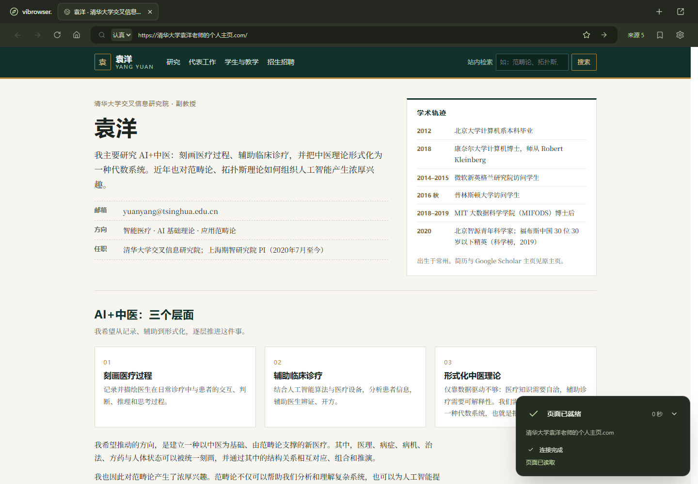

# 生成可靠性排查与修复

日期：2026-11-05。优先提高生成成功率，本轮没有以缩短等待时间为目标。

## 发现的问题

排查前保留的三次真实任务均进入过修复：两次成功，一次在 `binding element missing` 后失败。旧记录没有保留模型原文，只能定位错误类别，不能追溯每处 HTML。

增加逐次诊断后，真实调用捕获了这些具体问题：

| 原因 | 原行为 | 本轮处理 |
| --- | --- | --- |
| HTML ID 与独立 bindings 数组不一致 | 内容已经生成，整页仍失败；错误没指明哪条绑定 | 推荐直接在文本叶节点写实体标记，宿主分配 ID 并编译绑定。旧数组仅在明确标记或唯一、完整匹配的可见字段上重连；歧义仍报错 |
| 表单带普通 action/method 属性 | 已声明宿主搜索动作的表单被拒绝 | 对已绑定 Search/Submit 的表单移除冗余原生提交属性，继续由宿主提交 |
| form 使用 data-action-id，actions 指向不存在的 elementId | 搜索表单没有建立连接 | 唯一动作标记可建立元素 ID；重复标记不猜测 |
| 邮箱 mailto / 电话 tel 链接 | 被自动生成为网页导航，然后报笼统的 navigation target invalid；连续修复仍可能失败 | 保留联系方式文本和样式，不创建网页导航。其他非法目标会明确报告动作 ID 与目标 |
| 输出格式小差异 | 缺少空数组、数字状态、已知枚举大小写、外层代码围栏导致解码失败 | 仅在生成入口做确定性规范化；不猜测未知动作、不删除非法正文 |
| 修复反馈与上下文 | 错误泛化、修复请求累积、上一输出截断 | 提供绑定/动作/区域具体引用与现有 ID；每次使用原始需求、最新完整输出和当前错误 |

HTML/CSS、动作、实体与来源引用的检查仍执行。危险属性、脚本、外部资源、未知动作、重复 ID、歧义绑定及事实冲突不会通过上述规范化被放行。没有缩减布局、正文或交互数量来提高通过率。

## 生成预算与诊断

- v3 页面和区域更新共用最多 **4 次生成请求**；网络重试和内容修复共同计数。鉴权、额度与限流错误立即终止。
- 单次生成请求最多 **180 秒**；官方接口输出额度 **24,000 tokens**，自定义兼容接口暂保留 12,000。响应读取上限从 256 KiB 调整为 1 MiB，避免正常中文大页面被过小的字节上限拒绝。
- HTTP 客户端响应头等待 190 秒、读写空闲 200 秒；生成外层 180 秒预算优先。连接测试仍是小请求，最多 30 秒。
- 前端等待窗口从 4 分钟改为 20 分钟，保留取消、关闭标签和迟到响应隔离。认真模式的规划、Search/Fetch 预算维持原值。
- `generation_jobs.diagnostics` 保存有序尝试：序号、Accepted/InvalidContent/ProviderFailure、完整模型输出、错误与时间。内部 `RecordGenerationAttemptMessage.plan` 在短事务中写入，公开页面响应不返回诊断原文。
- 诊断只保存模型返回内容和应用错误，不保存凭据或 Authorization。它属于本机项目数据；临时任务按既有启动清理策略删除，书签任务随保留记录存在。本次原始回放语料另存 Git 忽略的 `.cache`，提交的验收 JSON 只含任务元数据与错误。

官方接口使用 `json_object`；合法 JSON 不意味着应用里的 DOM ID、实体与动作引用一定成立。接口参数依据 [DeepSeek Chat Completions](https://api-docs.deepseek.com/api/create-chat-completion/)。

## 自动检查

- Scala 格式化、编译与 PostgreSQL 测试：**82 项通过**。
- 可选真实输出回放：**1 项测试内 3 个失败首轮样本全部通过**。合计 sbt 输出 83 项通过。
- 回放只验证解码 → 规范化 → WebDocument 结构校验，没有模型请求，也不替代完整检索、继承或真实生成验收。
- 前端格式、42 项单测、类型检查与生产构建通过。
- 浏览器回归 **8 项通过**：三类 v3 运行时、中文输入法与连续搜索、模式/独立设置及认真模式界面。
- 真实定向复测脚本通过；另一次浏览器检查读取三页并渲染截图，确认没有 Navigate/Retry/Submit 生成请求。

新增回归覆盖：确定性绑定与 ID 冲突、歧义引用、多错误定位、数据属性动作绑定、表单兼容、联系方式、非法事件/协议、四次预算上限、鉴权单次终止、诊断持久化/迁移/接口不泄露、中文大响应。

本地回放命令（需要本机已捕获的 `.cache/generation-replay.json`）：

```powershell
$env:VIBROWSER_GENERATION_REPLAY = 'true'
.\scripts\database.ps1 start
.\scripts\sbt.ps1 'testOnly services.generation.GenerationReplaySuite'
Remove-Item Env:VIBROWSER_GENERATION_REPLAY
```

## 真实调用：保留失败，不混算首轮与最终成功

实际使用已有官方 DeepSeek 配置。以下都是 LIVE 调用，未用 Mock 代替。

### 加入诊断、尚未完成表单和联系方式修复时

| 场景 | 生成请求数 | 结果 |
| --- | ---: | --- |
| 人物主页 A | 2 | 表单 action/method 首次被拒，修复后成功 |
| 人物主页 B | 2 | data-action-id 未连接到元素 ID，修复后成功 |
| 幻觉模式论坛 | 1 | 首轮成功，29 个实体字段绑定 |
| 人物主页站内搜索“研究方向” | 1 | 首轮成功 |
| 搜索页点击返回原主页路径 | 4 | 失败；表单属性、mailto 导航和一次修复中的实体遗漏 |

这一组 **首轮 2/5，最终 4/5**。最后一个测试原本命名为 detail，但它选中了首页路径，因此只作为链接导航失败记录，不算详情页验收。已修改后续脚本的链接选择条件。

证据：[原始结果](acceptance/reliability-2026-11-05.json)、[逐次诊断](acceptance/reliability-attempts-2026-11-05.json)。

### 完成修复后定向复测

| 场景 | pageId | 生成请求数 | 结果 |
| --- | --- | ---: | --- |
| 原失败页面显式重试 | c35c35cc-25fd-411d-9da4-fd59bf39744f | 1 | 首轮成功，复用检索资料 |
| 全新“清华大学袁洋老师的个人主页.com” | 53c0d3da-96eb-4075-8a8b-eae6d9d77f64 | 2 | 首轮遗漏 siteStyle，补齐后成功 |
| 点击搜索结果中的人物主页条目 | 588a0e10-f5c4-4c22-b2e6-cf875e83408e | 1 | 首轮成功，在 Vibrowser 内生成目标页面 |

这一组 **首轮 2/3，最终 3/3**；三项分别等待约 20.5、77.6、48.1 秒，包含相关检索与轮询。新主页仍出现必需字段遗漏，有限修复已恢复。这是定向小样本，不作为整体成功率估计。

证据：[修复后结果](acceptance/reliability-retest-2026-11-05.json)、[失败首轮原文的本地回放](acceptance/reliability-replay-2026-11-05.json)。原失败任务 `8e3e8d6b-8e1e-4f9c-a260-2ffe1c4fd702` 保留在报告中，新的成功任务是 `905ff10c-c6a2-429f-8eb5-1404fbedeb7e`，没有覆盖失败结果。



## 后续优先级

1. 按错误类别扩充真实输出回放语料，区分传输失败、JSON/字段错误、DOM 绑定错误、交互语义与继承冲突。
2. 对频繁且语义明确的格式差异继续做确定性编译；对缺失 siteStyle、缺失实体等需要内容判断的问题保留模型修复，避免随意猜补。
3. 扩大站点类型与局部更新样本，分别统计首轮成功、修复成功及最终失败。保留全部尝试，不反复生成挑选成功案例。

本轮没有改变书签、模式隔离、缓存策略或课程架构。新增诊断数据类与枚举独立文件，消息组合 IO，SQL 位于 Table/Initializer。已有书签无需重建。

交付状态：已恢复正常 LIVE 启动（未设置保留临时页的测试开关），健康检查通过；重启前后书签 ID 集合一致，生成密钥配置仍可读取。未收藏页面按现有策略清理，验收元数据与本地回放样本已另行保留。


晚间补充：用户报告的“清华教师袁洋的个人学术主页.com”暴露出实体 fragment 被页面规范化误删的问题。已修复，真实重试和相同输入新生成通过；完整根因、八个历史输出回放及剩余模型错误见 [学术主页专项](ACADEMIC_FRAGMENTS.md)。
