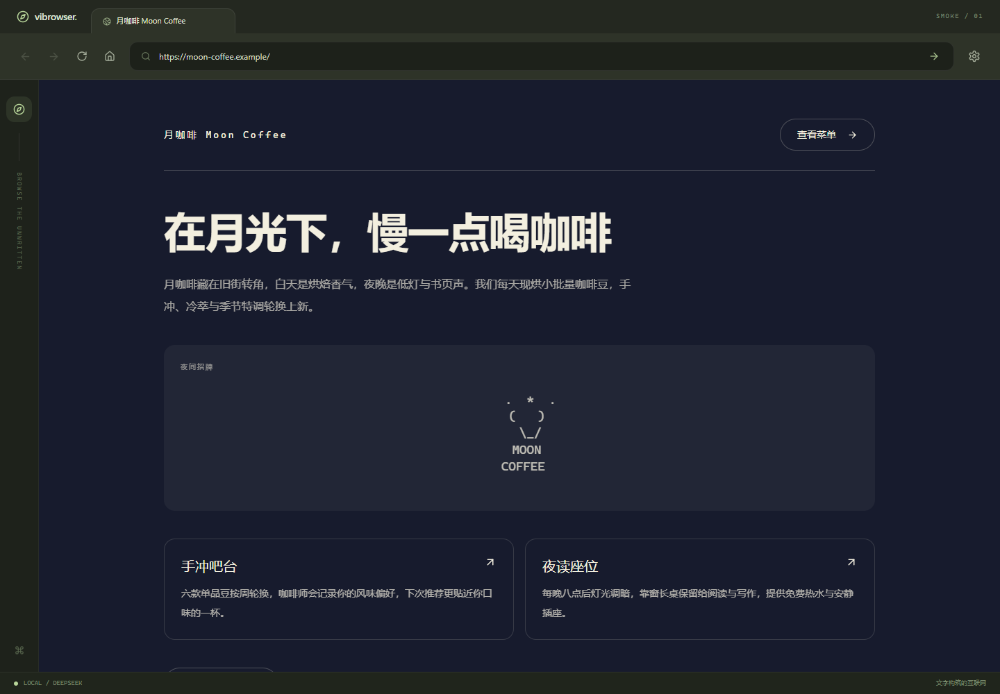

# 真实 DeepSeek Smoke 与故障修复

验收时间：2026-11-03 19:39–19:45（Asia/Shanghai）。接口为用户已配置的 DeepSeek 官方 / deepseek-flash。**真实连接通过，6/6 页面任务成功；缓存与应用重启恢复通过。**

本轮使用已有加密凭据，没有读取明文给前端、改写用户配置或将 Key 写入日志/提交。配置 revision 在验收前后均为 2。TokenHub 与自定义兼容接口未在本轮实测。

## 故障证据

排查开始时，真实 schema 中四个已访问页面全部失败：

| 输入 | 旧错误 |
| --- | --- |
| moon-coffee.example | 生成 JSON 字段不符合 PageSpec |
| cat.com | 生成 JSON 字段不符合 PageSpec |
| 猫窝 | 生成 JSON 字段不符合 PageSpec |
| future-botany.example | 组件总数须在 1–12 之间 |

经用户授权，单独发起一次诊断请求复现：返回文本本身是合法 JSON，但第一个导航子项是 `{"label":"豆单","href":"/beans"}`，缺少 PageBlock 的 id/type/items。精确解码错误为 `.blocks[0].items[0].id: Missing required field`。同份响应的网格卡片也使用无 id/type 的简写，全树 15 个组件，超过 12。

原因不在 Key 或连通性。JSON mode 保证 JSON 语法，并不保证应用的递归结构。原提示只有单层 hero 示例，没有演示完整嵌套，也没有具体组件预算；原修复请求又丢弃字段路径和失败原文，只要求“重新返回”，导致第二次输出仍可能重复错误。

诊断响应已作为 [provider 回归 fixture](../contracts/fixtures/provider/nested-shorthand.json) 保存。它是模型生成的虚构文本，不包含凭据；完整接口请求头不保存。

## 修复内容

1. **完整示例与预算。** Prompt 给出合法的九组件网站示例，导航内 button、网格内 card 均含完整字段；说明每个容器和子项都占一个名额。搜索推荐六组件布局，硬上限仍为 12/3 层。
2. **模型边界归一化。** 新增 generation 内部纯工具 GeneratedPageDecoder：在明确的父组件上下文中转换 label/href 导航和无 type 的标题卡片，按树路径补缺失 ID，补可空字段及空 items。模型简写不传播到前端契约。
3. **保留严格校验。** 显式未知类型、非法链接、重复 ID、超限组件和嵌套仍会失败；不截断组件、不丢弃不合格内容来伪造成功。
4. **有上下文的单次修复。** 解码错误保留字段路径，数量错误给出实际全树计数；唯一修复请求携带有上限的原输出和具体错误。模型调用预算仍最多两次、每次 60 秒。
5. **真实验收入口。** 新增独立 Playwright live 配置及显式启用开关。真实测试不会保存、替换或清除用户 Key，默认单元/Mock 测试也不会执行真实调用。

## 真实任务结果

通过浏览器交互执行设置连接测试、输入、失败页面重试、搜索和点击结果。所有内容均由真实接口生成，数据库 source=live。

| 页面任务 | 结果 | 导航至可见页面耗时 |
| --- | --- | --- |
| moon-coffee.example（原失败页） | ready / live | 3.7 秒 |
| 月球旅行 | ready / live，4 个结果 | 5.1 秒 |
| 点击“环月低轨观光航线七日” | ready / live，新目标页面 | 单独耗时未采集 |
| cat.com（原失败页） | ready / live | 4.5 秒 |
| 猫窝（原失败搜索） | ready / live | 4.4 秒 |
| future-botany.example（原失败页） | ready / live | 5.0 秒 |

连接测试任务 `9ddf2b4b-08cc-430c-ad51-54fb98079e05` 为 succeeded。完整页面 ID、任务 ID、内容 SHA-256 和重启证据见 [机器可读验收记录](acceptance/live-smoke-2026-11-03.json)。

6/6 是本组任务最终成功率，包含应用内部允许的一次修复；未单独记录每次模型请求，因此不宣称首轮请求 100% 成功，也不代表任意输入的成功率。未采集 usage/账单，不推算费用。

## 缓存、历史与重启

- 浏览器前进、后退、刷新和整页重载均通过，期间 navigate/retrypage 请求数为 0。
- 搜索页面的 currentJobId、PageSpec SHA-256 保持不变。
- 保存浏览器历史后实际结束并重启前后端与项目 PostgreSQL。
- 重启后六个页面均保持 ready/live，jobId 和内容 SHA-256 全部一致。
- URL、模型、revision、hasKey 与重启前一致；设置面板显示已配置。
- 用保存的浏览器 localStorage 恢复当前页，未发起新生成；页面 JS 错误数为 0。

## 自动检查

- 后端 **24 项通过**：原 18 项 + 6 项模型边界回归；真实 PostgreSQL 集成仍通过。
- 新回归覆盖：真实简写响应、合法归一化、未知组件字段路径、非法 href 不绕过校验、修复上下文及长度限制、完整 Prompt 示例本身合法。
- 前端 **9 项单测通过**；TypeScript、生产构建、Prettier 与 Scala 格式检查通过。
- **3 个真实浏览器测试阶段通过**：完整链路（32.5 秒），重启前准备（0.8 秒），重启后恢复（1.0 秒）。
- 原四项 Mock E2E 的首版结果保留在 [历史 Smoke 记录](SMOKE_PROGRESS.md)；本轮主验收使用真实接口，不以 Mock 代替。

## 重跑命令

先以默认真实模式启动应用，设置有效 Key。然后在 frontend 目录执行：

```powershell
$env:VIBROWSER_LIVE_SMOKE = 'true'
npm run test:live
npm run test:live:restart -- --grep prepare
# 在项目根目录停止并重新启动应用后，再执行：
npm run test:live:restart -- --grep 'restore settings'
Remove-Item Env:VIBROWSER_LIVE_SMOKE
```

test:live 会产生可能计费的请求，复用已有 ready 页面、显式重试 failed 页面；若要测全新生成，应记录使用的新地址，不能把命中缓存的重跑耗时当生成速度。重启两阶段本身只检查缓存，不调用模型。

可选开发诊断工具 LiveProviderProbe 在 Test 源集，需要显式设置 VIBROWSER_LIVE_PROBE=true 后运行 `Test / runMain services.generation.LiveProviderProbe`。它只发起一次请求，原始模型文本存入忽略目录 .data；不会自动进入测试流程。

## 真实界面证据

[连接成功](screenshots/live/connection.png) · [网页](screenshots/live/website.png) · [搜索](screenshots/live/search.png) · [点击后的页面](screenshots/live/linked-page.png) · [重启恢复](screenshots/live/restarted.png)



修复提交：`508b3cd`。验收脚本、截图与本记录在后续验收提交中保存。下一阶段可以推进站点一致性；本轮未新增虚构文件、生图或多标签能力。
